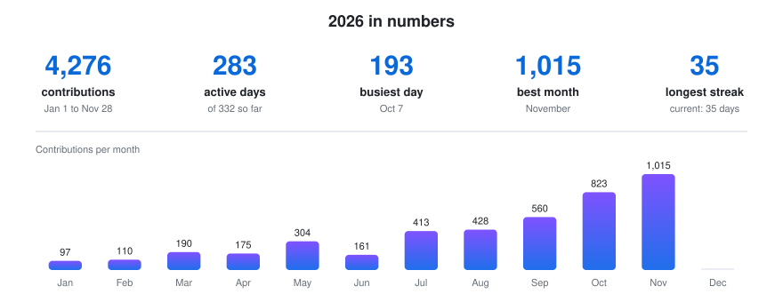

  
  
  

**Platform architect and software engineer** with 10+ years building production systems across distributed systems, backend, mobile, blockchain, machine learning and infrastructure.

 

### Selected work

- **AbySignal** (HashIT, 2025 to present): architected and built a network-quality platform for mobile carriers from the first commit: iOS and Android SDKs, multi-tenant backend, cloud infrastructure and CI/CD.
- **Solana trading system** (personal, 2026 to present): fully automated, **live and profitable**. A lock-free Rust execution engine lands buys **~120 ms** after the trigger; LightGBM models are served from Rust and retrained nightly with champion/challenger hot-swap.
- **iDA, intelligent device automation** (for Segron, 2025): the AI core that works out how to operate **a phone it has never seen**, plus an LLM agent that drives real phones toward a plain-language goal.
- **Ramo** (2023 to 2024): made Filecoin sector sealing **self-healing** and replaced lotus-miner with a single Rust daemon.
- **Redbox** (2020 to 2023): server-driven UI and **99.9%** crash-free users on a streaming app with **1M+** monthly users.
- **Earlier:** the core iOS platform at LotusFlare for mobile operators such as T-Mobile and A1, and AAA games at Ubisoft (Ghost Recon Wildlands, Steep).

 

### Activity

Most of my work lives in private repositories; these count it.

<picture>
  <source media="(prefers-color-scheme: dark)" srcset="https://raw.githubusercontent.com/joxoleon/joxoleon/output/activity-dark.svg" />
  
</picture>

<picture>
  <source media="(prefers-color-scheme: dark)" srcset="https://raw.githubusercontent.com/joxoleon/joxoleon/output/github-snake-dark.svg" />
  
</picture>

 

### Stack

 

Also: Solana · Filecoin · LightGBM · gRPC · MQTT · Cloudflare · SwiftUI · Fastlane

